<h1 align="center">
  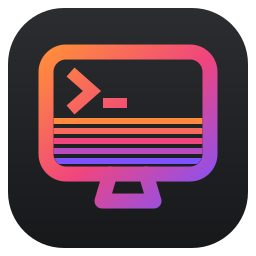<br>
  Retro Computing Themes
</h1>

<p align="center">
  14 color themes (plus a bonus) for VS Code inspired by the computers and tools many of us started on –<br>
  original palettes, tuned so code stays readable.
</p>

<p align="center">
  <a href="https://marketplace.visualstudio.com/items?itemName=andreashuthe.retro-computing-themes"></a>
  <a href="https://open-vsx.org/extension/andreashuthe/retro-computing-themes"></a>
  <a href="https://github.com/andreashuthe/retro-themes/actions/workflows/ci.yml"></a>
</p>

| Theme | Inspired by | |
|---|---|---|
| **Breadbin 64** | the Commodore 64 BASIC screen | dark |
| **Topaz 1.3** | the Amiga Workbench 1.3 | dark |
| **Blue Commander** | Norton Commander (DOS) | dark |
| **Turbo Blue** | the Borland Turbo Pascal 7 IDE | dark |
| **Green Desktop** | the Atari ST GEM desktop | light |
| **Platinum** | Mac OS 8/9 with CodeWarrior's syntax colors | light |
| **Program Manager** | Windows 3.1 | light |
| **Luna Blue** | Windows XP with Visual Studio 2005's syntax colors | light |
| **Green Phosphor** | green monochrome monitors (IBM 5151, Apple II, Commodore PET) | dark |
| **Amber Phosphor** | amber monochrome monitors | dark |
| **Pocket Green** | the original Game Boy | light |
| **Mode 1** | the Amstrad / Schneider CPC 464 | dark |
| **Page 100** | Teletext / Videotext | dark |
| **Black Cube** | NeXTSTEP | light |
| **Ocean Drive** *(bonus)* | neon sunsets over Miami Beach – not a computer, just a vibe | dark |

The screenshots use the recommended fonts (see below; *Page 100* is shown with the VGA font).

### Breadbin 64
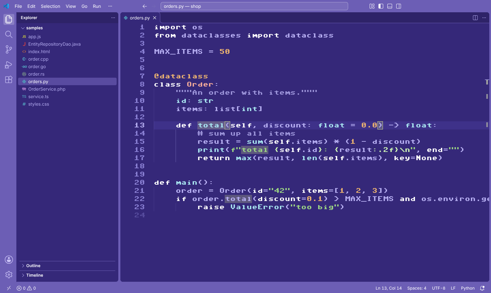

### Topaz 1.3
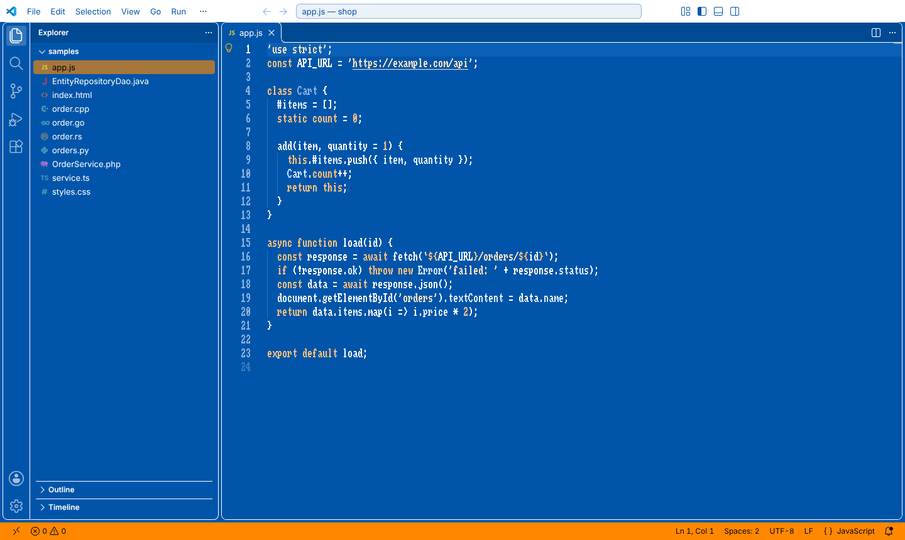

### Blue Commander
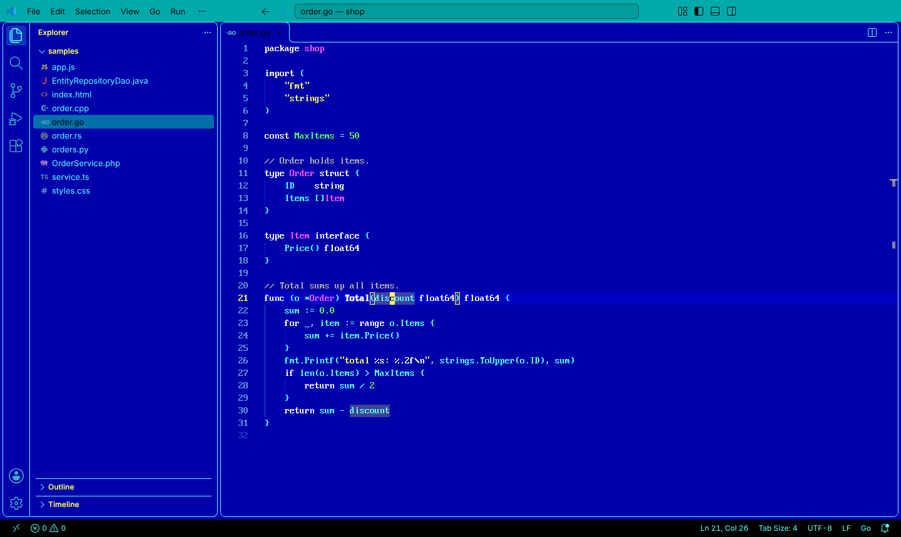

### Turbo Blue
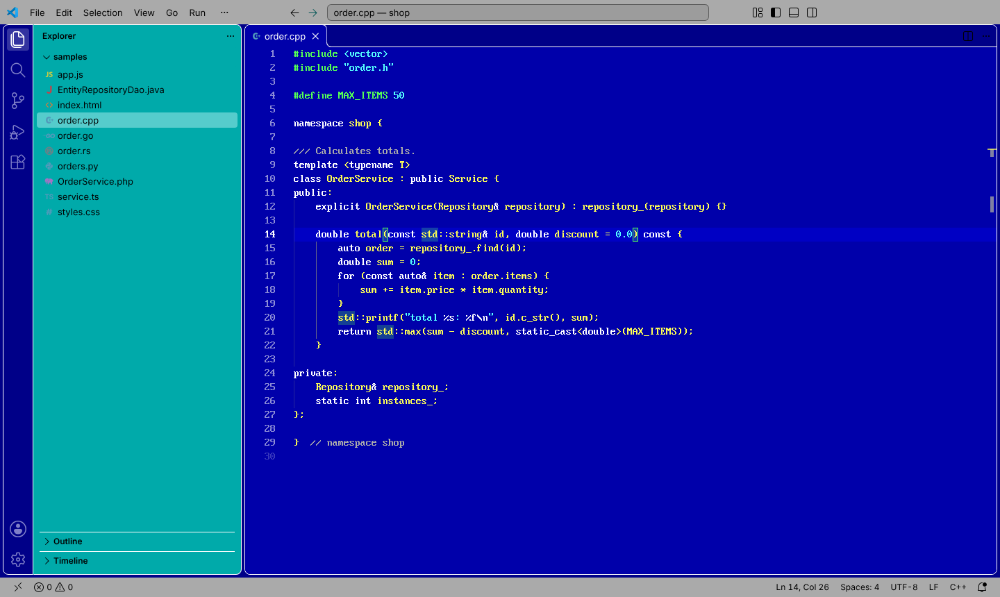

### Green Desktop
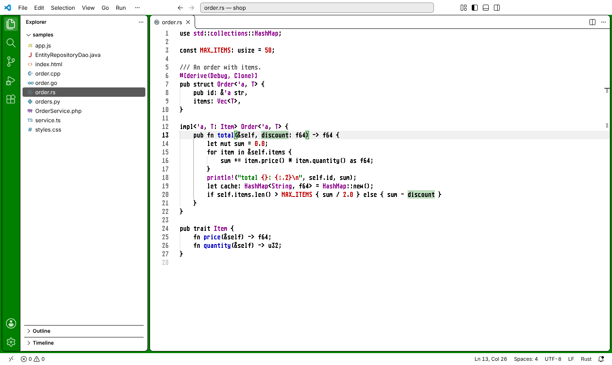

### Platinum
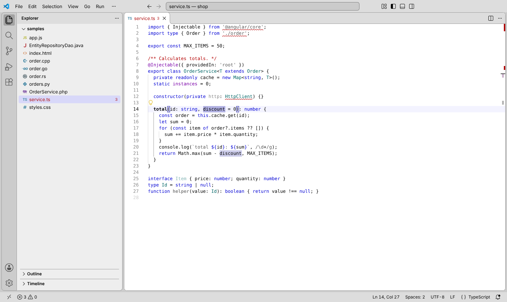

### Program Manager
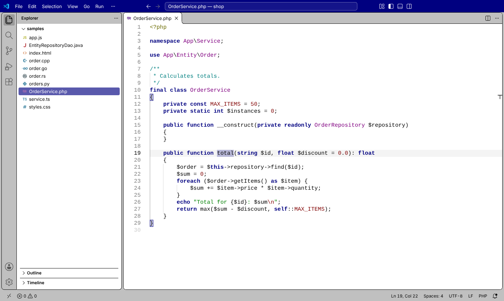

### Luna Blue
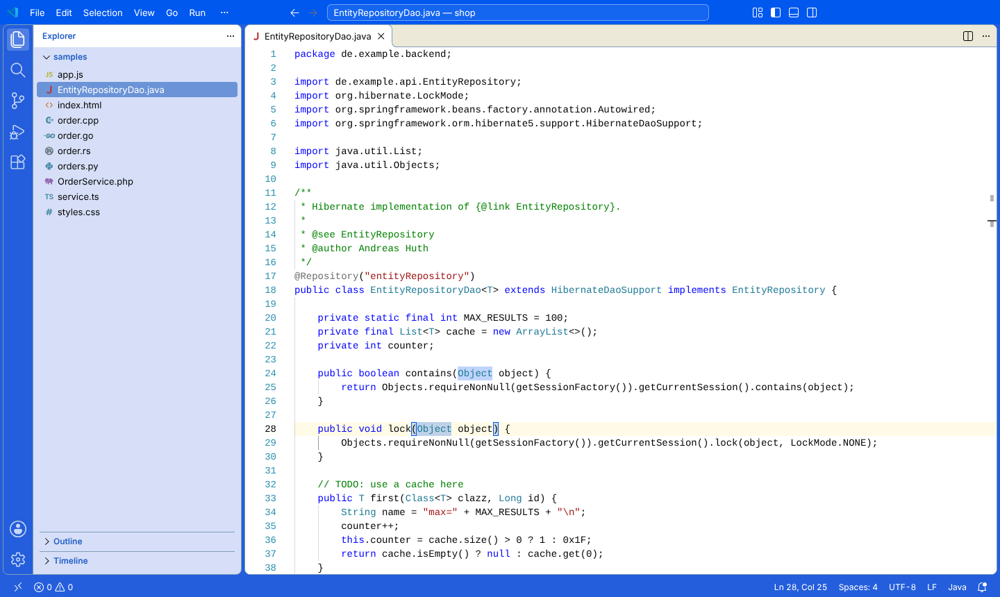

### Green Phosphor
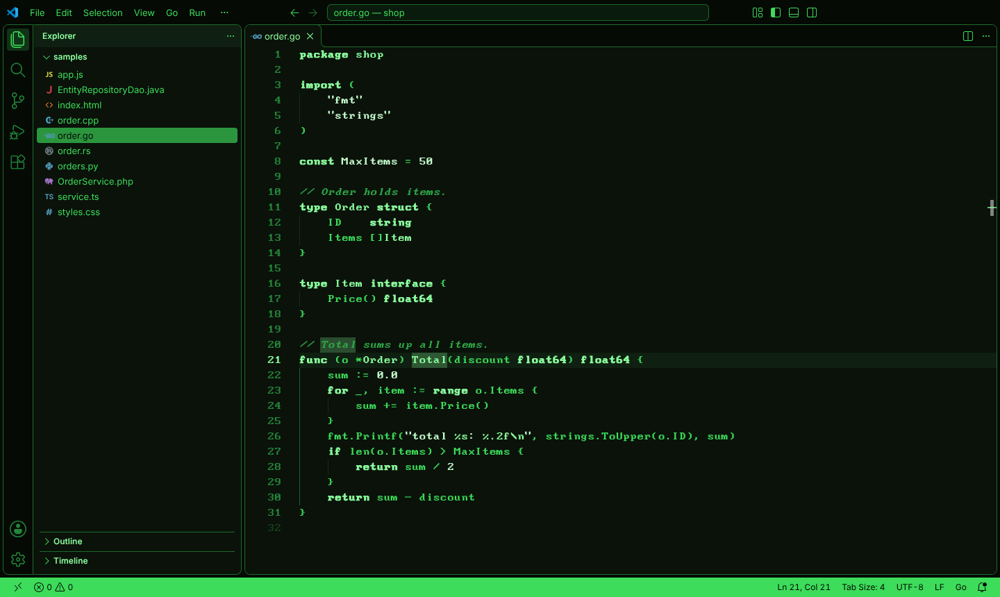

### Amber Phosphor
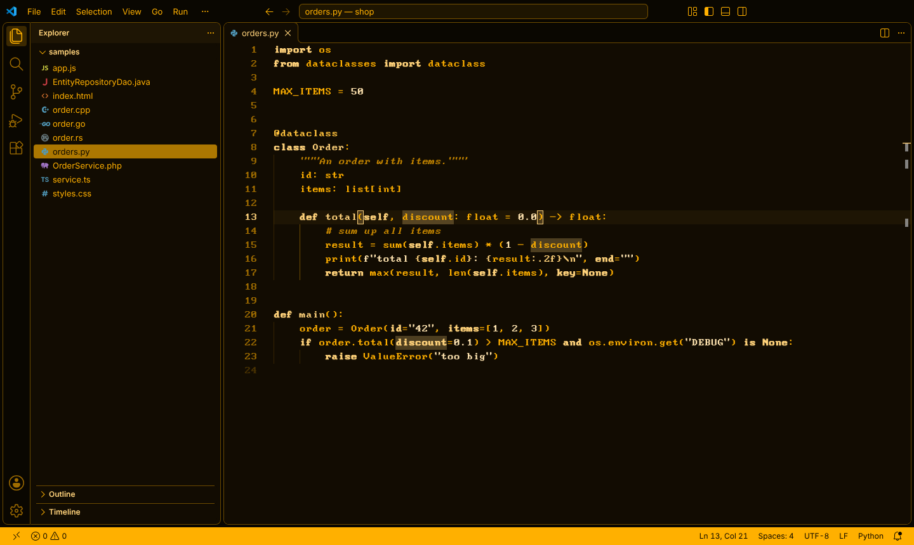

### Pocket Green
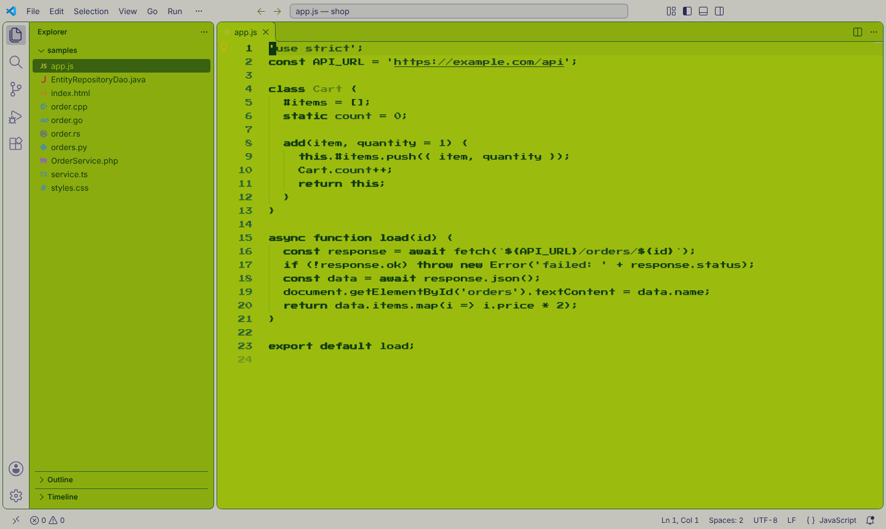

### Mode 1
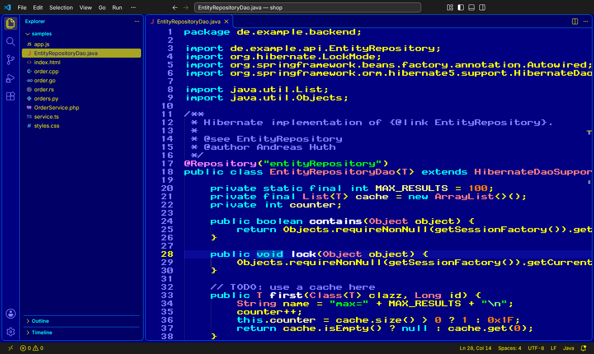

### Page 100
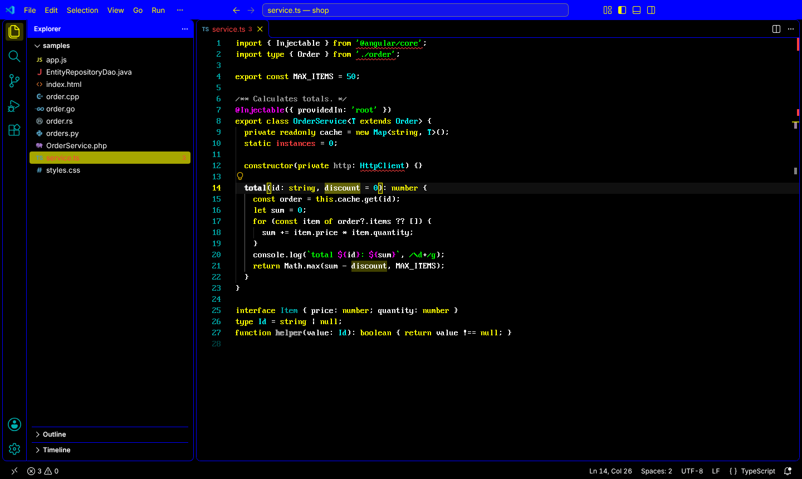

### Black Cube
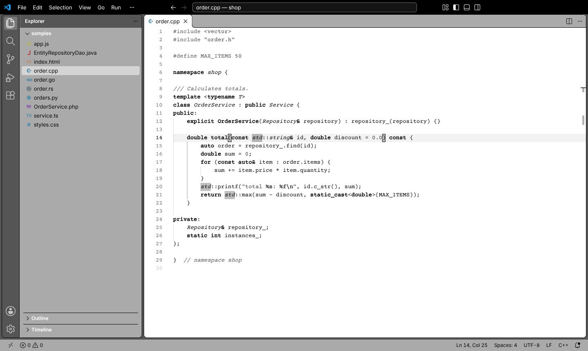

### Bonus: Ocean Drive
Neon pink keywords, turquoise strings, sunset-orange numbers and golden functions on a violet night sky – with a
status bar like a neon sign.

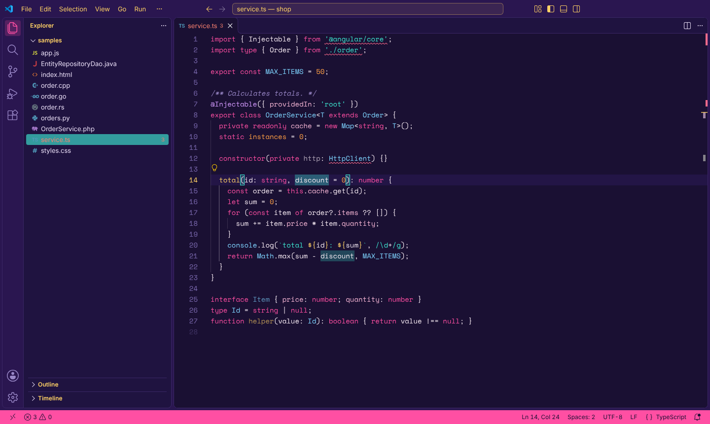

## Install

Install **Retro Computing Themes** from the
[VS Code Marketplace](https://marketplace.visualstudio.com/items?itemName=andreashuthe.retro-computing-themes) or
[Open VSX](https://open-vsx.org/extension/andreashuthe/retro-computing-themes) (Cursor, VSCodium, Windsurf, …),
then pick a theme (<kbd>⌘K</kbd> <kbd>⌘T</kbd> / <kbd>Ctrl+K</kbd> <kbd>Ctrl+T</kbd>).

## Original, but readable

The colors start from the real palettes – the C64's 16 colors, the Amiga's blue / white / black / orange, the
16 DOS text-mode colors, the Windows VGA palette. Some of them are too dark to read as code on their background
(the C64's light blue on blue, the Amiga's orange on blue), so they are lightened just enough. Every theme is
checked automatically: code reaches a WCAG contrast of at least 4.5:1, comments at least 4:1.

Other details:

- **The frame is part of the look**: with VS Code's modern layout the space around editor and side bar takes the
  "border" color – the C64's light blue frame, the green Atari desktop, the blue Windows XP taskbar.
- **Turbo Blue** has cyan side bar and panel like the IDE's watch / message windows, a grey menu bar and green
  menu highlights. **Blue Commander** has a cyan menu bar, grey dialogs and the black function key bar at the bottom.
- **Luna Blue** has the orange line on the active tab, yellow tooltips and a green "start button" in the status bar.
- **Green / Amber Phosphor** and **Black Cube** use a single color (or four greys) – syntax is told apart by
  brightness, bold and italics, like on the real monochrome screens. Status bar and selections use inverse video.
- **Pocket Green** has the four greens of the screen, the grey case around it and the magenta A/B buttons.
- **Mode 1** is yellow on blue from the CPC's 27-color palette with the black case and the green ENTER key.
- **Page 100** has the blue header row and the eight Teletext colors (plus grey comments, so they step back).
- No rainbow brackets – those screens had one text color.
- All languages work. Java, Kotlin, Python, TypeScript/JavaScript, HTML/CSS, PHP, C/C++, Go, Rust, JSON, YAML and
  Markdown are mapped in detail, including semantic highlighting.

## Recommended fonts

A theme can't change the font, but the right one makes the look complete. All fonts below are free; install them,
then add the settings to your `settings.json` (VS Code has no per-theme font settings, so switch them together with
the theme – or use a separate [profile](https://code.visualstudio.com/docs/configure/profiles) per theme).

| Theme | Font | Where to get it |
|---|---|---|
| Breadbin 64 | **C64 Pro Mono** | [Style – C64 TrueType](https://style64.org/c64-truetype) (free download, see their license) |
| Topaz 1.3 | **Topaz** (Kickstart 1.x) | [rewtnull/amigafonts](https://github.com/rewtnull/amigafonts) (GPL with font exception) – or `fonts-topaz-unicode` on Debian/Ubuntu |
| Blue Commander, Turbo Blue | **Px437 IBM VGA 8x16** | [The Ultimate Oldschool PC Font Pack](https://int10h.org/oldschool-pc-fonts/) by VileR (CC BY-SA 4.0) |
| Green Desktop | **Atari ST 8x16 system font** | [ntwk/atarist-font](https://github.com/ntwk/atarist-font) (BSD-3-Clause) – or `fonts-atarist` on Debian/Ubuntu |
| Platinum | **Monaco** | preinstalled on macOS; elsewhere [ProFont](https://tobiasjung.name/profont/) |
| Program Manager | **Fixedsys Excelsior** | free remake of the Windows 3.1 system font ([about Fixedsys](https://en.wikipedia.org/wiki/Fixedsys)) |
| Luna Blue | **Lucida Console** or **Courier New** | preinstalled on Windows |
| Green / Amber Phosphor | **Px437 IBM MDA** | [The Ultimate Oldschool PC Font Pack](https://int10h.org/oldschool-pc-fonts/) by VileR (CC BY-SA 4.0) |
| Pocket Green | **Press Start 2P** | [Google Fonts](https://fonts.google.com/specimen/Press+Start+2P) (SIL OFL) |
| Mode 1 | **Px437 Amstrad PC** | [The Ultimate Oldschool PC Font Pack](https://int10h.org/oldschool-pc-fonts/) – Amstrad's PC1512 font; there's no maintained free CPC font |
| Page 100 | **Bedstead** | [bjh21.me.uk/bedstead](https://bjh21.me.uk/bedstead/) (public domain) – or `fonts-bedstead` on Debian |
| Ocean Drive | **Space Mono** | [Google Fonts](https://fonts.google.com/specimen/Space+Mono) (SIL OFL) |
| Black Cube | **Courier Prime** | [Google Fonts](https://fonts.google.com/specimen/Courier+Prime) (SIL OFL) – NeXT's own Ohlfs isn't freely licensed |

Pixel fonts look sharpest at their native size or a multiple of it (8 or 16 px). Settings used for the screenshots:

```jsonc
// Breadbin 64
"editor.fontFamily": "'C64 Pro Mono', monospace",
"editor.fontSize": 16,
"editor.lineHeight": 24,
"editor.cursorStyle": "block",
"editor.cursorBlinking": "phase",

// Topaz 1.3 (the Debian package names the font "Topaz Unicode KS13")
"editor.fontFamily": "'Topaz a500a1000a2000', 'Topaz Unicode KS13', monospace",
"editor.fontSize": 16,
"editor.lineHeight": 22,
"editor.cursorStyle": "block",

// Blue Commander
"editor.fontFamily": "'Px437 IBM VGA 8x16', monospace",
"editor.fontSize": 16,
"editor.lineHeight": 20,
"editor.cursorStyle": "block",
"editor.cursorBlinking": "solid",

// Turbo Blue – underline cursor like the DOS IDE
"editor.fontFamily": "'Px437 IBM VGA 8x16', monospace",
"editor.fontSize": 16,
"editor.lineHeight": 20,
"editor.cursorStyle": "underline",
"editor.cursorBlinking": "blink",

// Green Desktop (the Debian package names the font "Atari")
"editor.fontFamily": "'Atari ST', 'Atari', monospace",
"editor.fontSize": 16,
"editor.lineHeight": 20,
"editor.cursorStyle": "block",

// Platinum
"editor.fontFamily": "Monaco, ProFontWindows, ProFont, monospace",
"editor.fontSize": 13,
"editor.lineHeight": 18,

// Program Manager
"editor.fontFamily": "'Fixedsys Excelsior 3.01', 'Fixedsys Excelsior', 'Courier New', monospace",
"editor.fontSize": 16,
"editor.lineHeight": 20,

// Luna Blue
"editor.fontFamily": "'Lucida Console', 'Courier New', monospace",
"editor.fontSize": 14,
"editor.lineHeight": 20,

// Green Phosphor / Amber Phosphor (Amber: "underline" cursor)
"editor.fontFamily": "'Px437 IBM MDA', monospace",
"editor.fontSize": 18,
"editor.lineHeight": 22,
"editor.cursorStyle": "block",

// Pocket Green
"editor.fontFamily": "'Press Start 2P', monospace",
"editor.fontSize": 12,
"editor.lineHeight": 22,
"editor.cursorStyle": "block",

// Mode 1 – 40 columns like the CPC
"editor.fontFamily": "'Px437 Amstrad PC', monospace",
"editor.fontSize": 16,
"editor.lineHeight": 20,
"editor.cursorStyle": "block",

// Page 100
"editor.fontFamily": "Bedstead, monospace",
"editor.fontSize": 16,
"editor.lineHeight": 20,
"editor.cursorStyle": "block",

// Black Cube
"editor.fontFamily": "'Courier Prime', Courier, monospace",
"editor.fontSize": 14,
"editor.lineHeight": 20,

// Ocean Drive
"editor.fontFamily": "'Space Mono', monospace",
"editor.fontSize": 14,
"editor.lineHeight": 22,
"editor.cursorBlinking": "expand",
```

Also nice for all of them: `"editor.fontLigatures": false` and `"editor.bracketPairColorization.enabled": false`.

## Good to know

- **Colors only**: no CSS hacks – bevels, gradients and pixel patterns of the originals aren't possible with a
  VS Code theme. Window shapes come from VS Code itself.
- **Icons**: the file icon theme isn't part of a color theme; on the cyan side bar of *Turbo Blue* a monochrome
  icon theme (or `"workbench.iconTheme": null`) looks most authentic.
- Fonts with only a regular style show bold text with synthetic bold.

## Development

```bash
npm install
npm test               # regenerates themes/*.json from scripts/palettes.js and checks contrast + colors per language
npm run test:vscode    # once: downloads VS Code (its grammars are used by the language tests)
npm run screenshots    # docs/*.png via Playwright (npm i --no-save playwright), Linux: xvfb-run -a …
npx vsce package       # .vsix
```

`themes/*.json` are **generated** – change the palettes in [`scripts/palettes.js`](scripts/palettes.js) (colors per
syntax role and UI part) instead. [`scripts/scopes.js`](scripts/scopes.js) maps TextMate scopes and semantic tokens to
the syntax roles. Press <kbd>F5</kbd> in VS Code to try the themes in an Extension Development Host.
Releases: see [RELEASING.md](RELEASING.md).

## License

[MIT](LICENSE). The themes contain no fonts, logos or other material of the original systems.
Commodore, Amiga, Atari, Norton Commander, Turbo Pascal, Borland, Apple, Mac OS, CodeWarrior, Microsoft, Windows,
Visual Studio, IBM, Nintendo, Game Boy, Amstrad, Schneider, NeXT and NeXTSTEP are trademarks of their respective owners; this project is not affiliated with or endorsed by any
of them.
